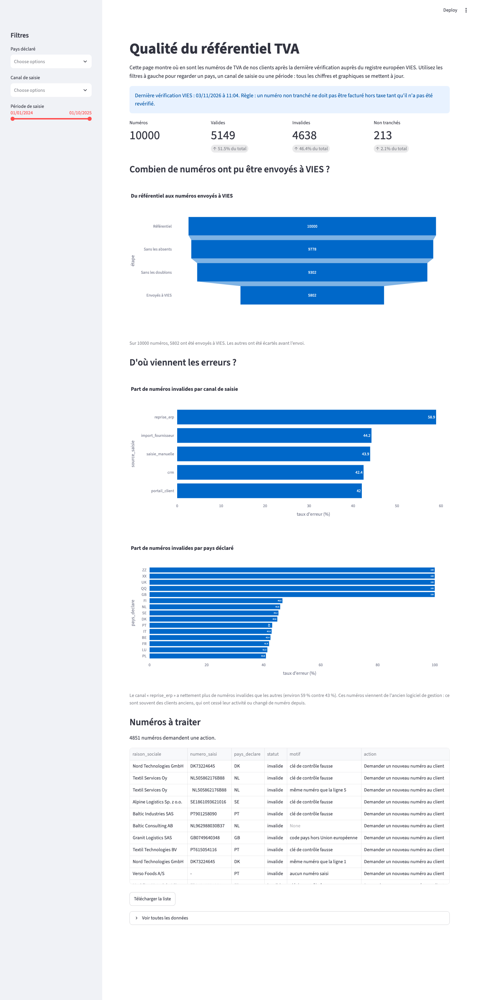

# Tableau de bord TVA avec Streamlit — corrigé

Corrigé du brief « Un tableau de bord TVA avec Streamlit » (Data Analyst, niveau 1).

La directrice financière de Meridian Distribution suit dans son navigateur la qualité des
10 000 numéros de TVA intracommunautaire du référentiel clients, après la campagne de
vérification VIES. La page montre :

- les quatre chiffres clés : numéros, valides, invalides, non tranchés ;
- l'entonnoir, du référentiel aux numéros envoyés à VIES ;
- la part de numéros invalides par canal de saisie et par pays ;
- la liste des numéros à traiter, avec l'action à mener, téléchargeable en CSV pour Excel.

Les filtres pays, canal et période se cumulent, et tous les chiffres réagissent aux filtres.



## Technologies

| Outil | Pourquoi |
|---|---|
| Python 3.11 à 3.14 | les versions du `requirements.txt` ne s'installent pas sur un Python plus ancien |
| pandas | lit le CSV, filtre et compte |
| Streamlit | transforme le script en page web, sans HTML ni JavaScript |
| Plotly Express | entonnoir et graphiques en barres, avec la valeur écrite sur chaque barre |

## Installation et lancement

```bash
git clone https://github.com/gsoulat/corrige-brief-tva-streamlit.git
cd corrige-brief-tva-streamlit
python3 -m venv .venv
source .venv/bin/activate        # Windows : .venv\Scripts\activate
pip install -r requirements.txt
streamlit run app.py
```

La page s'ouvre sur http://localhost:8501.

## Chiffres à retrouver

| Filtre | Numéros | Valides | Invalides | Non tranchés |
|---|---:|---:|---:|---:|
| Aucun | 10 000 | 5 149 (51,5 %) | 4 638 (46,4 %) | 213 (2,1 %) |
| Pays FR | 974 | 555 | 408 | 11 |
| Canal reprise_erp | 2 071 | 804 | 1 219 | 48 |
| FR et reprise_erp | 197 | 93 | 100 | 4 |

Entonnoir sans filtre : 10 000 → 9 778 → 9 302 → 5 802. Numéros à traiter : 4 851.

Les colonnes du fichier de données sont décrites dans [`data/LISEZMOI.md`](data/LISEZMOI.md).

## Auteur

Guillaume Soulat
